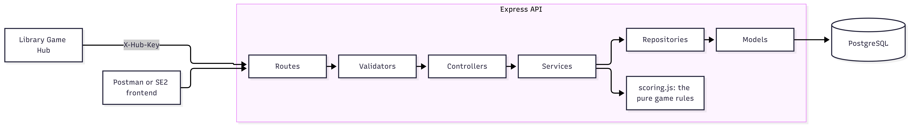
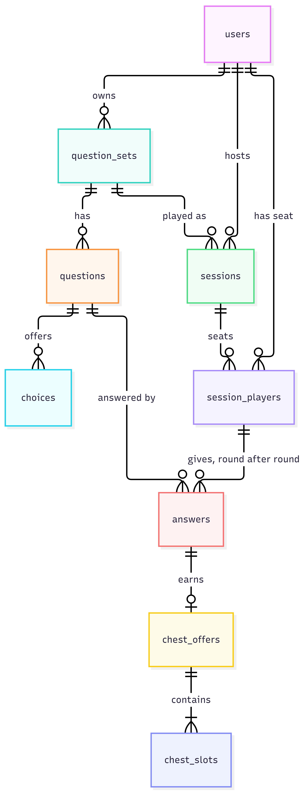

# Technical specification: Reach For The Stars API

Version 1.0.0, SE1 final build. Developer: Nickson M. Formento (kennus4m2), BSCS 3-1. Group: Team 5.

## 1. Purpose and scope

Reach For The Stars is a timed trivia game. A host builds question sets of multiple-choice questions and starts a session with a join code. Players join with a nickname and answer questions on their own for the length of the session, earning stars for correct and fast answers, building streaks, using power-ups (double star, protection) and opening reward chests. When the timer ends, the session closes and the final scores stand. The Library Game Hub reads the finished games through `GET /results`, which needs the `X-Hub-Key` header and accepts `?since=` to return only games that ended after a given time. For each game it lists every player with their stars, whether they completed it and their rank, and a podium of the top three, and the library turns that into XP. The Hub also uses `GET /game-info` (the game's slug, name, version and developer) and `GET /health`.

SE1 covers the backend: the REST API, the PostgreSQL database, authentication, game rules, tests and deployment on Render. SE2 will add the frontend that players and hosts use, built against this API (see `se2-handoff.md`).

## 2. Architecture

A request enters the Express app, passes the global middleware (CORS, JSON body parsing, security headers), then matches a route. The route runs authentication and role checks, then the validator for that endpoint. Valid requests reach the controller, which reads the request and calls one service. The service applies the game rules and calls repositories for data. Repositories use the Sequelize models to talk to PostgreSQL. The result travels back up the same path, and a central error handler turns any failure, including database constraint violations, into a consistent error response.

| Layer | Folder | Responsibility | Never |
|---|---|---|---|
| Routes | `src/routes` | Map URLs and HTTP methods to controllers and attach authentication, role and validation middleware. | Contain business logic or touch the database. |
| Validators | `src/validators` | Check the shape and types of params, query and body before anything runs. | Check rules that need the database or game state. |
| Controllers | `src/controllers` | Translate between HTTP and services: read the request, call a service, send the response. | Hold game rules or run queries. |
| Services | `src/services` | Apply the game rules: scoring, streaks, power-ups, chests, pacing, session timing, transactions and locks. | Read `req` or `res`, or build HTTP responses. |
| Repositories | `src/repositories` | Run the queries for each table and return plain data to services. | Decide game rules or know about HTTP. |
| Models | `src/models` | Define the tables, columns and associations for Sequelize. | Contain behavior beyond describing the data. |

## 3. Data

The database has 9 tables: `users`, `question_sets`, `questions`, `choices`, `sessions`, `session_players`, `answers`, `chest_offers` and `chest_slots`. Every table and column is described in [data-dictionary.md](data-dictionary.md).

The database enforces its own rules, so they hold even if application code has a bug:

- **UNIQUE:** one account per school ID, username and email (`users_school_id_key`, `users_username_key`, `uq_users_email`); one join code per session (`sessions_join_code_key`); one seat per account per session (`uq_one_seat`); one nickname per session (`uq_player_nickname`); one position per question in a set (`uq_question_position`); one index per choice in a question (`uq_choice_index`); one chest offer per answer (`chest_offers_answer_id_key`); one slot number per offer (`uq_chest_slot_number`).
- **CHECK:** user role (`ck_users_role`), session status (`ck_session_status`), chest status (`ck_chest_status`), slot number 1 to 3 (`ck_slot_number_1_to_3`), positive question time (`ck_question_time_positive`), and stars never negative (`ck_stars_not_negative`).
- **Foreign keys:** deleting a parent removes its children where that is safe (`ON DELETE CASCADE`), clears optional links (`SET NULL` on `answers.choice_id` and `session_players.current_question_id`), and blocks deletion where history must survive (`RESTRICT` on `session_players.user_id` and `sessions.question_set_id`).

In `constraint-map.js`, each named constraint is mapped to an error code and a readable message, so a violation reaches the client as a clean error response instead of a raw database error. For example, `uq_player_nickname` becomes 409 `NICKNAME_TAKEN`, `users_school_id_key` becomes 409 `SCHOOL_ID_TAKEN`, `uq_users_email` becomes 409 `EMAIL_TAKEN`, and the foreign key `sessions_question_set_id_fkey` (a question set that a game used cannot be deleted) becomes 409 `QUESTION_SET_IN_USE`.

## 4. Security

| Concern | Decision |
|---|---|
| Passwords | Stored only as bcrypt hashes (`password_hash`, 60 characters) with a cost factor of 10, set by `BCRYPT_ROUNDS`. Plain passwords are never stored, logged or returned. Passwords are 8 to 72 characters because bcrypt reads only 72 bytes. |
| Login and tokens | `POST /auth/login` returns a signed JWT (HS256) valid for 1 hour (`JWT_EXPIRES_IN`), signed with the secret in `JWT_SECRET`. The client sends it as `Authorization: Bearer <token>`. A wrong password and an unknown school ID both answer 401 `INVALID_CREDENTIALS` with the same message, so login cannot be used to discover which accounts exist. A missing token is 401 `AUTH_REQUIRED` and a changed or expired one is 401 `INVALID_TOKEN`. |
| Roles | Each user has one role in `users.role` (default `PLAYER`), limited by `ck_users_role` to PLAYER, HOST and ADMIN. Registration always creates a PLAYER, whatever the request asks for. Routes list the roles that may call them, and the role check runs before validation, so a stranger learns nothing about the rules. Only an admin can change a role, and an admin cannot change their own. The first admin is created from environment variables by `scripts/create-admin.js`. |
| Input | Every endpoint validates params, query and body before the controller runs, and every error answers `{ "error": { "code", "message" } }`. Database queries go through Sequelize, which parameterizes values, and list sorting is restricted to an allow-list of columns. Uploads accept one PNG or JPEG of at most 1 MB and are renamed by the server. |
| Your game's trust boundary | The server decides everything that affects the score: which question a player is served, when it was served, how long the answer took, whether it was correct (an answer after the time limit counts as wrong) and how many stars it earns. The client only sends the `question_id` and the `choice_id`. The correct choice is never sent to players. |
| Browsers (CORS) | A CORS allow-list built from the `CORS_ORIGINS` environment variable (comma-separated). A browser page from any other origin does not get the `access-control-allow-origin` header. Requests with no origin, such as Postman, curl and the Hub, are not affected by CORS. `helmet` adds the standard security headers. |
| The Hub | The Library Game Hub sends its secret in the `X-Hub-Key` header, compared with `HUB_API_KEY`, a long random value set only in the Render dashboard. Without it `/results` answers 401 `HUB_KEY_REQUIRED`. The key opens `/results` only and cannot be used on any other endpoint. |

## 5. Quality

The project has 50 Jest tests in 9 suites, all passing, running 86.8% of the lines in `src`. The unit tests check the scoring rules at their edges (0 ms, the time limit, one millisecond over), login failures and the answer rules, with the repositories replaced by `jest.mock`, so they need no database. The HTTP tests use supertest on a separate test database (`<DB_NAME>_test`) and cover accounts and roles, question sets and the question bank, joining and rejoining, playing, the looping questions and the game timer ending. The Postman collection has 84 requests and 147 tests, and passes on a fresh database (`npm run db:reset`), also from the command line with newman. The OpenAPI document describes 29 operations. After every push, GitHub Actions rebuilds the project on a clean machine and runs the automatic check (criteria A to O); the latest run on `main` is green.

## 6. Deployment

The API runs as a Render web service (Node) with a Render PostgreSQL 18 database, both in the Singapore region, defined by a Blueprint (`render.yaml`) in the `kennus4m2/reach-for-the-stars-api` repository, branch `main`. The start command is `npm run start:render`, which runs `sequelize-cli db:migrate`, then `scripts/create-admin.js`, then `src/server.js`, so the schema is current and an admin exists before the server accepts requests. Database settings (`DB_HOST`, `DB_PORT`, `DB_NAME`, `DB_USER`, `DB_PASSWORD`) and the admin credentials come from environment variables, never from the repository. No seed data is loaded on Render, so the live API starts empty.

Live address: https://reach-for-the-stars-kennus4m2.onrender.com/api/v1. Free-plan limits: the web service spins down after 15 minutes without requests, so the first request after idle time takes about a minute while it wakes up, and a client should wait and retry. The free PostgreSQL database expires 30 days after it was created ([the date you created it]), after which the data is gone unless the plan is upgraded or the database is recreated. There is no persistent disk, so uploaded cover pictures vanish when the service restarts or redeploys.

## 7. Decisions and their reasons

| Decision | Reason | Alternative not taken |
|---|---|---|
| Questions loop until the timer ends | A short question set still keeps every player busy, and the score reflects speed and accuracy over the whole time. Cost accepted: a player can answer the same question many times, so "one answer per question" became "one answer per question served" and `uq_one_answer_per_question` was dropped. | A single pass through the set, which ends a player's game early and rewards only one attempt per question. |
| The clock closes the game (`endIfTimeIsUp`), not only the host | Results exist even if a host forgets to end the session. Cost accepted: a read request can change a game's status. | Only the host ends the game, which leaves sessions open and scores unfinalized when the host leaves. |
| One answer per served question, enforced by a row lock | Two simultaneous answers cannot both be saved. Cost accepted: one extra lock per answer. | Checking in application code only, which two parallel requests can both pass. |
| Independent pacing, with a pointer per player | Fits "answer trivia independently". Cost accepted: players do not see the same question at the same time. | One shared question for the whole session, controlled by the host. |
| The server measures time and decides stars | Clients cannot cheat on speed or score. Cost accepted: network delay counts against the player. | Trusting a time and score reported by the client. |
| Layers: route, controller, service, repository | Rules and queries stay testable in isolation. Cost accepted: more files. | Putting logic directly in route handlers. |
| One seat per account per game (`uq_one_seat`) | A returning player gets the same seat back. Cost accepted: one account cannot play two seats. | Allowing several seats per account, which splits a player's score and streak. |
| No seed data on Render, first admin from environment variables | No default credentials or demo data in production. Cost accepted: the live API starts empty. | Seeding sample data and a fixed admin account on every deploy. |